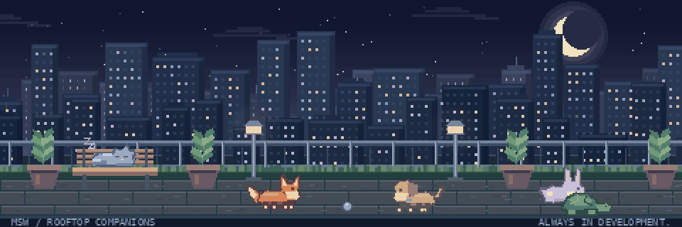

<!-- MSW / LIVING IDENTITY — profile README -->

  <picture><source media="(prefers-reduced-motion: reduce) and (prefers-color-scheme: light)" srcset="./assets/still/hero-muhammad-v3-light.svg" /><source media="(prefers-reduced-motion: reduce)" srcset="./assets/still/hero-muhammad-v3-dark.svg" /><source media="(prefers-color-scheme: light)" srcset="./assets/hero-muhammad-v3-light.svg" /><source media="(prefers-color-scheme: dark)" srcset="./assets/hero-muhammad-v3-dark.svg" /></picture>

  <a href="https://www.linkedin.com/in/muhammad-sahid-wahyudi-151a762b2/"><picture><source media="(prefers-reduced-motion: reduce) and (prefers-color-scheme: light)" srcset="./assets/still/social/linkedin-light.svg" /><source media="(prefers-reduced-motion: reduce)" srcset="./assets/still/social/linkedin.svg" /><source media="(prefers-color-scheme: light)" srcset="./assets/social/linkedin-light.svg" /><source media="(prefers-color-scheme: dark)" srcset="./assets/social/linkedin.svg" /></picture></a>
  <a href="mailto:muhammad.sahid.wahyudi05@gmail.com"><picture><source media="(prefers-reduced-motion: reduce) and (prefers-color-scheme: light)" srcset="./assets/still/social/email-light.svg" /><source media="(prefers-reduced-motion: reduce)" srcset="./assets/still/social/email.svg" /><source media="(prefers-color-scheme: light)" srcset="./assets/social/email-light.svg" /><source media="(prefers-color-scheme: dark)" srcset="./assets/social/email.svg" /></picture></a>
  <a href="https://discord.com/users/1129314713986158614"><picture><source media="(prefers-reduced-motion: reduce) and (prefers-color-scheme: light)" srcset="./assets/still/social/discord-light.svg" /><source media="(prefers-reduced-motion: reduce)" srcset="./assets/still/social/discord.svg" /><source media="(prefers-color-scheme: light)" srcset="./assets/social/discord-light.svg" /><source media="(prefers-color-scheme: dark)" srcset="./assets/social/discord.svg" /></picture>
  <a href="https://daily.dev/kallenkaslana"><picture><source media="(prefers-reduced-motion: reduce) and (prefers-color-scheme: light)" srcset="./assets/still/social/dailydev-light.svg" /><source media="(prefers-reduced-motion: reduce)" srcset="./assets/still/social/dailydev.svg" /><source media="(prefers-color-scheme: light)" srcset="./assets/social/dailydev-light.svg" /><source media="(prefers-color-scheme: dark)" srcset="./assets/social/dailydev.svg" /></picture></a>

 · <a href="https://kallen-kaslan.github.io/kallen-kaslan/">Explore Creative Lab ↗</a> · <a href="./README-accessible.md">Motion-free profile</a>

<!-- 01 / Introduction -->

## About me

An Informatics Engineering student who enjoys exploring **web development, creative design, and digital media.**

Currently learning web technologies through hands-on projects and AI-assisted development (vibe coding).

Also passionate about video editing, motion graphics, and UI/UX design.

<picture><source media="(prefers-reduced-motion: reduce) and (prefers-color-scheme: light)" srcset="./assets/still/identity-signal-light.svg" /><source media="(prefers-reduced-motion: reduce)" srcset="./assets/still/identity-signal.svg" /><source media="(prefers-color-scheme: light)" srcset="./assets/identity-signal-light.svg" /><source media="(prefers-color-scheme: dark)" srcset="./assets/identity-signal.svg" /></picture>

<!-- 02 / Toolkit -->
## Creative toolkit

<picture><source media="(prefers-reduced-motion: reduce) and (prefers-color-scheme: light)" srcset="./assets/still/creative-toolkit-v2-light.svg" /><source media="(prefers-reduced-motion: reduce)" srcset="./assets/still/creative-toolkit-v2-dark.svg" /><source media="(prefers-color-scheme: light)" srcset="./assets/creative-toolkit-v2-light.svg" /><source media="(prefers-color-scheme: dark)" srcset="./assets/creative-toolkit-v2-dark.svg" /></picture>

View all 17 tools as text

- **Web development:** React, Laravel, PHP, JavaScript, Tailwind CSS, HTML5, CSS3.
- **Development tools:** PostgreSQL, Docker, Git, VS Code.
- **Motion graphics and video:** After Effects, Premiere Pro, DaVinci Resolve, Alight Motion.
- **UI/UX and visual design:** Figma, Canva.

<!-- 03 / Activity -->
## Activity in motion

A visual representation of my GitHub contributions through a daily calendar and weekly activity signal.

<picture><source media="(prefers-reduced-motion: reduce) and (prefers-color-scheme: light)" srcset="./assets/still/contribution-signal-light.svg" /><source media="(prefers-reduced-motion: reduce)" srcset="./assets/still/contribution-signal.svg" /><source media="(prefers-color-scheme: light)" srcset="./assets/contribution-signal-light.svg" /><source media="(prefers-color-scheme: dark)" srcset="./assets/contribution-signal.svg" /></picture>

<!-- 04 / Creative experiment -->
## Beyond the static

<a href="https://kallen-kaslan.github.io/kallen-kaslan/"><picture><source media="(prefers-reduced-motion: reduce) and (prefers-color-scheme: light)" srcset="./assets/still/creative-lab-preview-optimized-light.svg" /><source media="(prefers-reduced-motion: reduce)" srcset="./assets/still/creative-lab-preview-optimized-dark.svg" /><source media="(prefers-color-scheme: light)" srcset="./assets/creative-lab-preview-optimized-light.svg" /><source media="(prefers-color-scheme: dark)" srcset="./assets/creative-lab-preview-optimized-dark.svg" /></picture></a>

<a href="https://kallen-kaslan.github.io/kallen-kaslan/"><strong>Launch Interactive Experience ↗</strong></a>

<!-- ==========================================
     05. ROOFTOP COMPANIONS
=========================================== -->

 

  <h3>Thanks for Watching.</h3>

  
A little world beyond the code.

  

   

  Muhammad Sahid Wahyudi — Always in Infromatics Engineer.

