<!-- MSW / LIVING IDENTITY — profile README -->

  

  
  
  
  

Discord: kallen-kaslan · <a href="https://kallen-kaslan.github.io/kallen-kaslan/">Explore Creative Lab ↗</a>

<!-- 01 / Introduction -->
## About me

An Informatics Engineering student who enjoys exploring **web development, creative design, and digital media.**

Currently learning web technologies through hands-on projects and AI-assisted development (vibe coding).

Also passionate about video editing, motion graphics, and UI/UX design.

<!-- 02 / Toolkit -->
## Creative toolkit

View all 17 tools as text

- **Web development:** React, Laravel, PHP, JavaScript, Tailwind CSS, HTML5, CSS3.
- **Development tools:** PostgreSQL, Docker, Git, VS Code.
- **Motion graphics and video:** After Effects, Premiere Pro, DaVinci Resolve, Alight Motion.
- **UI/UX and visual design:** Figma, Canva.

<!-- 03 / Activity -->
## Activity in motion

A visual representation of my GitHub contributions through a daily calendar and weekly activity signal.

Generated using GitHub GraphQL API · Scheduled daily updates

<!-- 04 / Creative experiment -->
## Beyond the static

<a href="https://kallen-kaslan.github.io/kallen-kaslan/"><strong>Launch Interactive Experience ↗</strong></a>

Hover or tap · Create ripples · Morph between scenes · Change the environment

Always in development.

